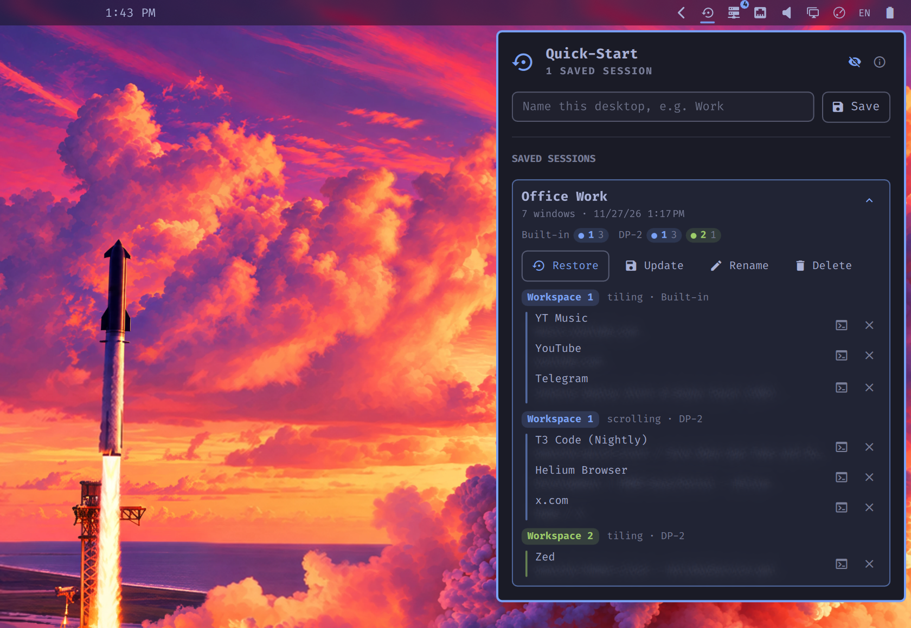

# Quick-Start

Quick-Start is an [Omarchy](https://omarchy.org) bar widget that saves open Hyprland windows into named sessions and restores them on demand. It runs no background service, timers, or auto-save, so it uses zero CPU while idle.



## Features

- Save, restore, update, rename, and delete named sessions from the bar.
- Expand a session to view windows by workspace, remove individual windows, or edit a launch command.
- Move matching open windows into place and launch only missing apps. Unrelated windows stay open.
- Restore dwindle, scrolling, and floating layouts with saved split ratios, column widths, floating geometry, and pinned state.
- Build launch commands when saving from desktop entries, AppImage files, Chromium web apps, and terminal directories in Ghostty, Alacritty, Kitty, and Foot.
- Match monitors by make and model across ports. Disconnected screens fall back to the focused monitor and scale floating windows to fit.
- Blur window titles, URLs, and folders in the preview with the eye button or the <kbd>b</kbd> key. Hover a row to read it.
- Track launched windows over the Hyprland event socket with bar progress, a 15 second timeout per app, and cancel support.
- Skip portals, auth prompts, picture-in-picture windows, and the screensaver.

## Requirements

- Omarchy with Hyprland 0.56 or newer using Lua configuration
- `python3` using the standard library only

## Install

```bash
omarchy plugin add https://github.com/TouchSeyha/omarchy-quick-start.git --enable
```

The widget installs to the right section of the bar. Move it with this command:

```bash
omarchy bar move touchseyha.quick-start --section right
```

## Usage

Click the bar icon to open the panel. Type a session name and press <kbd>Enter</kbd> or click Save.

Keyboard shortcuts when the panel is open:

| Key | Action |
| --- | --- |
| <kbd>Up</kbd> / <kbd>Down</kbd>, <kbd>j</kbd> / <kbd>k</kbd> | Select a session |
| <kbd>Enter</kbd> / <kbd>Space</kbd> | Restore the selected session |
| <kbd>s</kbd> | Focus the name field |
| <kbd>e</kbd> | Show or hide the selected session's windows |
| <kbd>u</kbd> | Update the selected session with the current desktop |
| <kbd>r</kbd> | Rename the selected session |
| <kbd>x</kbd> / <kbd>Delete</kbd> | Delete the selected session. Press twice to confirm. |
| <kbd>c</kbd> | Cancel a running restore |
| <kbd>b</kbd> | Blur or show window titles, URLs, and folders |
| <kbd>?</kbd> / <kbd>i</kbd> | Show or hide the help text |
| <kbd>Escape</kbd> | Close the panel |

Middle-click the bar icon to cancel a running restore.

### IPC and hotkeys

```bash
omarchy-shell touchseyha.quick-start toggle        # open or close the panel
omarchy-shell touchseyha.quick-start restore Work  # restore a session by name
omarchy-shell touchseyha.quick-start cancel        # cancel a running restore
```

To bind the panel to a hotkey, add a binding to `~/.config/hypr/bindings.lua`:

```lua
o.bind("SUPER + ALT + R", "Quick-Start sessions", "omarchy-shell touchseyha.quick-start toggle")
```

## Configuration

Add optional settings to the widget entry in `~/.config/omarchy/shell.json`:

```json
{
  "id": "touchseyha.quick-start",
  "includeSpecialWorkspaces": false,
  "ignoreClasses": "com.onepassword.OnePassword, steam*",
  "blurDetails": false
}
```

| Option | Default | Description |
| --- | --- | --- |
| `includeSpecialWorkspaces` | `false` | Save windows on special workspaces such as the scratchpad |
| `ignoreClasses` | `""` | Comma-separated app classes to skip when saving. Supports `*` wildcards. |
| `blurDetails` | `false` | Blur window titles, URLs, and folders in the session preview |

## Data

Quick-Start stores each session as a JSON file in `~/.local/state/omarchy/quick-start/slots/<id>.json` and uses `$XDG_STATE_HOME` when set. Because session files contain the launch commands that run on restore, restore only files you created. When restoring a workspace layout mode, Quick-Start also writes that mode to `~/.local/state/omarchy/workspace-layouts/` so it persists across logins.

## Remove

```bash
omarchy plugin remove touchseyha.quick-start
```

To delete saved sessions as well:

```bash
rm -rf ~/.local/state/omarchy/quick-start
```

## Development

```bash
python3 -m unittest discover -s tests
node --test tests/
omarchy plugin validate .
```

If you symlink a local clone into `~/.config/omarchy/plugins/`, run `omarchy restart shell` after editing. The plugin watcher does not follow symlinks, so edits in a symlinked folder do not hot-reload.

## License

MIT
